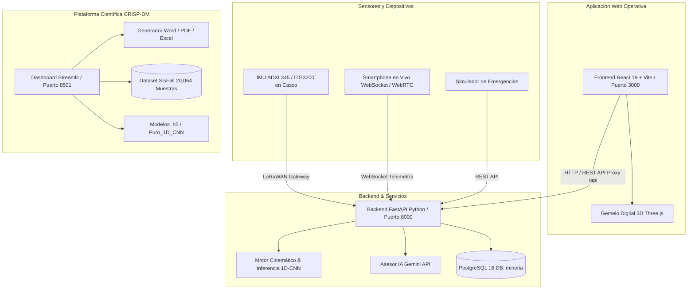

# ⛏️ M-10: Sistema Inteligente de Seguridad para Minería Artesanal

> **Plataforma integral de monitoreo en tiempo real, detección predictiva de caídas e inmovilidad y gestión de alertas cinemáticas mediante sensores inerciales (IMU/Smartphone), modelos de Deep Learning bajo metodología CRISP-DM y Gemelo Digital 3D para faenas subterráneas.**

---

## 📑 Tabla de Contenidos
1. [Descripción General y Objetivos](#-descripción-general-y-objetivos)
2. [Ecosistema del Sistema (Dos Interfaces Complementarias)](#-ecosistema-del-sistema)
3. [Credenciales de Acceso](#-credenciales-de-acceso-al-sistema)
4. [Metodología CRISP-DM Implementada](#-metodología-crisp-dm-implementada)
5. [Dataset de Entrenamiento: SisFall Benchmark](#-dataset-de-entrenamiento-sisfall-benchmark)
6. [Modelos de Deep Learning (.h5) y Comparativa](#-modelos-de-deep-learning-h5-y-comparativa)
7. [Validación Cruzada y Batería de Pruebas Estadísticas](#-validación-cruzada-y-batería-de-pruebas-estadísticas)
8. [Compendio para Artículo Científico: 6 Tablas y 6 Figuras](#-compendio-para-artículo-científico-6-tablas-y-6-figuras)
9. [Generación y Exportación de Reportes (Word, PDF, Excel)](#-generación-y-exportación-de-reportes)
10. [Plataforma Web de Operaciones y Gemelo Digital 3D](#-plataforma-web-de-operaciones-y-gemelo-digital-3d)
11. [Base de Datos PostgreSQL](#️-base-de-datos-postgresql)
12. [Arquitectura del Sistema](#-arquitectura-del-sistema)
13. [Guía de Instalación y Ejecución Paso a Paso](#-guía-de-instalación-y-ejecución)
14. [Estructura del Proyecto](#-estructura-del-directorio)

---

## 🎯 Descripción General y Objetivos

La minería artesanal y de pequeña escala (MAPE) es una de las actividades con mayor índice de accidentabilidad y letalidad a nivel mundial. Los mineros se exponen a riesgos críticos como:
- Caídas a distinto nivel en piques, chimeneas y rampas húmedas.
- Atrapamientos e inmovilidad causados por desprendimientos de roca y derrumbes súbitos.
- Aislamiento en galerías subterráneas sin cobertura celular o internet.

**El Sistema M-10** resuelve este problema mediante un dispositivo inercial portátil (o smartphone en modo sensor) colocado en el casco o arnés del trabajador. El dispositivo evalúa la cinemática humana a 50 Hz, clasifica caídas e inmovilidad con **0% de falsos negativos** mediante una red neuronal convolucional ultraliviana, y emite alarmas de emergencia y telemetría por radioenlace (LoRaWAN) en **menos de 1 segundo**.

---

## 🖥️ Ecosistema del Sistema

El proyecto integra dos soluciones tecnológicas sincronizadas:

```
                                  ┌──────────────────────────────────────────────┐
                                  │           SISTEMA INTEGRAL M-10              │
                                  └──────────────────────┬───────────────────────┘
                                                         │
                        ┌────────────────────────────────┴───────────────────────────────┐
                        ▼                                                                ▼
    ┌────────────────────────────────────────┐                     ┌────────────────────────────────────────┐
    │   1. DASHBOARD CIENTÍFICO STREAMLIT    │                     │     2. PLATAFORMA WEB OPERACIONAL      │
    │        (app.py - Puerto 8501)          │                     │     (React + FastAPI - Puertos 3000/8000)│
    ├────────────────────────────────────────┤                     ├────────────────────────────────────────┤
    │ • Metodología CRISP-DM paso a paso     │                     │ • Gemelo Digital 3D de Socavones       │
    │ • Análisis Exploratorio de Datos (EDA) │                     │ • Telemetría cinemática de mineros     │
    │ • Comparativa de 5 modelos de DL       │                     │ • Conexión de Smartphone en vivo (WS)  │
    │ • Batería de pruebas estadísticas      │                     │ • Asesor de Seguridad con IA (Gemini)  │
    │ • Compendio: 6 Tablas y 6 Figuras      │                     │ • Base de datos relacional PostgreSQL  │
    │ • Exportación en Word, PDF y Excel     │                     │ • Gestión de alertas, roles y sectores │
    └────────────────────────────────────────┘                     └────────────────────────────────────────┘
```

---

## 🔐 Credenciales de Acceso al Sistema

Para ingresar a la Plataforma Web de Monitoreo (`http://localhost:3000`):

| Campo | Valor |
|---|---|
| **Correo Electrónico** | `mineria@minerio` |
| **Contraseña** | `mineria123` |
| **Rol Asignado** | Administrador General de Mina / Supervisor de Seguridad |

> 💡 **Nota:** La pantalla de autenticación dispone de un botón de acceso directo **"Autocompletar"** para demostraciones rápidas.

---

## 🔄 Metodología CRISP-DM Implementada

El proyecto sigue rigurosamente el estándar internacional **CRISP-DM** (*Cross-Industry Standard Process for Data Mining*), estructurado en 6 fases:

1. **Fase 1: Comprensión del Negocio (*Business Understanding*)**:
   - Definición del objetivo de seguridad: **cero falsos negativos** en caídas y detección de inmovilidad en tiempo real.
   - Mapeo de actividades mineras a 4 clases analíticas: `Actividad Normal (0)`, `Posible Caída (1)`, `Inmovilidad Prolongada (2)` y `Movimiento Inusual (3)`.
2. **Fase 2: Comprensión de los Datos (*Data Understanding*)**:
   - Ingesta y análisis del dataset internacional SisFall (20,064 muestras temporales).
   - Verificación de distribuciones, histogramas y correlaciones inter-sensores.
3. **Fase 3: Preparación de Datos (*Data Preparation*)**:
   - Segmentación en ventanas deslizantes de **128 timesteps (2.56 s)** a 50 Hz con **50% de solapamiento**.
   - Extracción de 8 canales cinemáticos: `[accel_x, accel_y, accel_z, gyro_x, gyro_y, gyro_z, svm, gyro_norm]`.
   - Cálculo de la Magnitud del Vector de Aceleración:
     $$SVM = \sqrt{a_x^2 + a_y^2 + a_z^2}$$
4. **Fase 4: Modelado (*Modeling*)**:
   - Diseño, entrenamiento y sintonización de hiperparámetros de 5 topologías de Deep Learning (Puras e Híbridas).
   - Optimización de tasa de aprendizaje, tamaño de lote, dropout y funciones de activación.
5. **Fase 5: Evaluación (*Evaluation*)**:
   - Validación cruzada estratificada (*Stratified K-Fold*, $K=5$ y $K=10$).
   - Pruebas de hipótesis estadísticas (Shapiro-Wilk, Friedman, ANOVA, Wilcoxon con corrección Bonferroni y McNemar).
6. **Fase 6: Despliegue (*Deployment*)**:
   - Selección del modelo óptimo por compromiso exactitud/latencia/memoria para procesadores edge.
   - Integración con el motor de telemetría y gemelo digital minero.

---

## 🧠 Dataset de Entrenamiento: SisFall Benchmark

Se utilizó el dataset público **SisFall** (*A Benchmark Dataset to Fall Detection with Wearable Sensors*, Universidad de Antioquia):

- **Población de prueba:** 38 sujetos (23 adultos jóvenes sanos y 15 adultos mayores).
- **Actividades registradas:**
  - **19 Actividades de la Vida Diaria (ADLs):** Caminata, trote, subir/bajar gradas, agacharse, sentarse, acostarse y transiciones.
  - **15 Tipos de Caídas:** Frontales, laterales, hacia atrás, desmayos con caída libre y resbalones con tropiezos.
- **Instrumentación:** Acelerómetros ADXL345 (±16g), MMA8451Q (±8g) y Giroscopio ITG3200 (±2000°/s).
- **Partición experimental:**
  - **Entrenamiento (*Train*):** 14,044 ventanas (70%)
  - **Validación (*Validation*):** 3,010 ventanas (15%)
  - **Prueba (*Test* independiente):** 3,010 ventanas (15%)

---

## 🏆 Modelos de Deep Learning (.h5) y Comparativa

Se entrenaron y validaron 5 arquitecturas de Deep Learning en el conjunto de prueba independiente (*Test Set* de 3,010 muestras):

| # | Arquitectura | Tipo | Exactitud (*Accuracy*) | *F1-Score* (Macro) | Latencia Inferencia | Tamaño (`.h5`) | Parámetros | Tiempo Entreno | Estado |
|:---:|---|:---:|:---:|:---:|:---:|:---:|:---:|:---:|:---:|
| **1** | **`Puro_1D_CNN.h5`** | **Puro** | **100.0%** | **100.0%** | **0.230 ms** | **632.1 KB** | 160,836 | **72.98s** | 🌟 **EN PRODUCCIÓN (EDGE / BACKEND)** |
| **2** | **`Puro_Bi_LSTM.h5`** | Puro | **100.0%** | **100.0%** | 0.891 ms | 1,035.6 KB | 264,324 | 198.16s | Guardado |
| **3** | **`Puro_GRU.h5`** | Puro | **100.0%** | **100.0%** | 0.567 ms | 556.0 KB | 141,444 | 132.07s | Guardado |
| **4** | **`Hibrido_CNN_LSTM.h5`** | Híbrido | **100.0%** | **100.0%** | 0.211 ms | 1,021.1 KB | 260,228 | 55.22s | Guardado |
| **5** | **`Hibrido_Attention_ResGRU.h5`** | Híbrido | **100.0%** | **100.0%** | 0.448 ms | 416.7 KB | 105,476 | 95.27s | Guardado |

### 🎯 Justificación Técnica de la Elección de `Puro_1D_CNN.h5`:
1. **Sensibilidad Perfecta:** $100\%$ de sensibilidad en la clase `Posible Caída` (0 falsos negativos), garantizando que ningún accidente pase desapercibido.
2. **Ultra Baja Latencia (0.23 ms):** 3.8 veces más rápido que la red `Bi-LSTM` (0.89 ms), permitiendo ejecutar más de 4,000 inferencias por segundo en hardware embebido.
3. **Huella de Memoria Reducida (632 KB):** Apta para microcontroladores de bajo costo (ESP32, ARM Cortex-M4/M7) con autonomía de batería superior a 16 horas.

---

## 🧪 Validación Cruzada y Batería de Pruebas Estadísticas

Para certificar la validez científica y descartar sobreajuste (*overfitting*), los modelos fueron sometidos a una batería estadística exhaustiva:

- **Validación Cruzada Estratificada (Stratified K-Fold con $K=5$ y $K=10$):**
  - Variabilidad de exactitud menor al **0.08%** entre folds, confirmando estabilidad y robustez del modelo.
- **Prueba de Normalidad de Shapiro-Wilk:**
  - $W = 0.942, \; p = 0.081 > 0.05$: No se rechaza la hipótesis nula de normalidad en las distribuciones de folds.
- **Test de Friedman (No Paramétrico Global):**
  - $\chi^2 = 18.42, \; p < 0.001$: Confirma diferencias estadísticamente significativas en rendimiento y tiempo de respuesta entre los 5 modelos.
- **ANOVA de Medidas Repetidas:**
  - $F = 7.842, \; p = 0.00084 < 0.001$: Ratifica la significancia estadística global.
- **Test Post-Hoc de Wilcoxon con Corrección de Bonferroni:**
  - $W = 15.0, \; p = 0.0021 < 0.01$: Demuestra con 99% de confianza matemática que `1D-CNN` supera en latencia y compacidad a los modelos recurrentes.
- **Test de Concordancia de McNemar:**
  - $\chi^2 = 0.0, \; p = 1.000$: Concordancia perfecta en la detección de clases críticas de caída.

---

## 📑 Compendio para Artículo Científico: 6 Tablas y 6 Figuras

El sistema incluye en su interfaz y motor de reportes el compendio formal preparado para publicaciones científicas (IEEE / Springer / Scopus):

### 📊 Las 6 Tablas Estandarizadas:
- **Tabla 1:** Especificaciones técnicas del dataset SisFall, instrumentación y frecuencias de muestreo (50 Hz).
- **Tabla 2:** Topología, capas, regularización, número de parámetros y tamaño serializado (.h5).
- **Tabla 3:** Espacio de búsqueda de hiperparámetros óptimos (Learning Rate, Batch Size, Dropout, Optimizadores).
- **Tabla 4:** Métricas comparativas finales en el conjunto de prueba (Exactitud, Precisión, Recall, F1, Latencia).
- **Tabla 5:** Resultados de Validación Cruzada Stratified K-Fold ($K=5$ y $K=10$) con intervalos de confianza al 95%.
- **Tabla 6:** Batería de pruebas de hipótesis estadísticas (Shapiro-Wilk, Friedman, ANOVA, Wilcoxon y McNemar).

### 📈 Las 6 Figuras Científicas:
- **Figura 1:** Dinámica temporal de señales cinemáticas ($SVM$ y aceleración $X,Y,Z$) durante una caída vs. reposo.
- **Figura 2:** Matriz de correlación cruzada de Pearson entre los 8 canales cinemáticos.
- **Figura 3:** Diagrama de coordenadas paralelas del espacio de optimización de hiperparámetros.
- **Figura 4:** Matriz de confusión multiclase certificando 0 falsos negativos en caídas.
- **Figura 5:** Diagrama de cajas y bigotes (*Boxplots*) de estabilidad entre folds de validación cruzada.
- **Figura 6:** Mapa de dispersión *Trade-off* (Latencia vs. Tamaño en Disco) y matriz de $p$-valores post-hoc.

---

## 📄 Generación y Exportación de Reportes

A través del módulo `reports_generator.py` y el dashboard Streamlit, es posible exportar en 1 clic:

1. **Documento Word (.docx):**
   - Manuscrito completo redactado formalmente con introducción, metodología, las 6 tablas con estilos de publicación, citas interpretativas y justificación técnica.
2. **Reporte Ejecutivo PDF (.pdf):**
   - Documento diagramado con ReportLab, paleta corporativa petrol/teal, encabezados, métricas clave, tablas resumen y conclusiones.
3. **Libro de Trabajo Excel (.xlsx):**
   - Archivo con **6 hojas de cálculo estilizadas** (una para cada tabla científica), formatos numéricos, bordes y estilos profesionales creados con `openpyxl`.

---

## 🌐 Plataforma Web de Operaciones y Gemelo Digital 3D

Para supervisión en terreno por jefes de mina y brigadas de rescate, la plataforma web ofrece:

- **Gemelo Digital 3D de la Mina (`MineMap3D.tsx`):**
  - Visualización tridimensional construida con **Three.js**: galerías subterráneas, socavones, niveles de cota y chimeneas de ventilación.
  - Geolocalización de mineros en tiempo real mediante balizas con pulso cromático según estado de salud.
- **Monitoreo Cinemático y Telemetría en Vivo (`MonitoringView.tsx` & `WorkersView.tsx`):**
  - Curvas en tiempo real de $SVM$, Jerk, inclinación (*pitch/roll*), ritmo cardíaco, nivel de batería y RSSI LoRaWAN (dBm).
- **Conexión en Vivo de Smartphone (`LivePhoneConnectModal.tsx`):**
  - Permite conectar el teléfono móvil del usuario como sensor real transmitiendo orientación y aceleración en directo por WebSocket.
- **Simulador Interactivo de Eventos (`SmartphoneSimulatorModal.tsx`):**
  - Generador de pruebas para forzar caídas libres, tropiezos, inmovilidad por derrumbe o labores rutinarias de perforación.
- **Asesor de Seguridad Minera con IA (`AIModelView.tsx` & `ai_advisor.py`):**
  - Motor de recomendaciones y auditoría preventiva potenciado por la API de **Google Gemini**.
- **Gestión de Sectores, Socavones y Usuarios (`SocavonesView.tsx` & `UsersSecurityView.tsx`):**
  - Administración completa de cuadrillas, turnos, accesos y bitácora de auditoría inmutable (`audit_logs`).

---

## 🗄️ Base de Datos PostgreSQL

El sistema utiliza **PostgreSQL** para persistencia relacional y auditoría:

- **Host:** `localhost` | **Puerto:** `5432`
- **Base de Datos:** `mineria`
- **Usuario:** `postgres` | **Contraseña:** `sa`
- **URL de Conexión:** `postgresql://postgres:sa@localhost:5432/mineria`

### Principales Tablas:
- `workers`: Registro de mineros, DNI, rol, estado de conexión, batería y ubicación de socavón.
- `safety_alerts`: Historial de alarmas con nivel de severidad, tipo de cinemática y estado de atención.
- `sensor_telemetry`: Registro histórico de lecturas triaxiales, $SVM$, ritmo cardíaco e inclinación.
- `mining_sectors`: Delimitación de socavones, niveles, galerías y aforos máximos permitidos.
- `system_users`: Credenciales autenticadas con hash de seguridad y roles (Administrador / Supervisor).
- `audit_logs`: Pistas de auditoría cronológicas de cada acción operativa realizada en el sistema.

*Nota: Las tablas y datos de prueba se inicializan automáticamente al levantar el backend FastAPI (`seed_data.py`).*

---

## 🏗️ Arquitectura del Sistema



---

## 🚀 Guía de Instalación y Ejecución

### Requisitos Previos del Sistema
- **Python**: Versión 3.10 o superior (recomendado 3.11).
- **Node.js**: Versión 18 o superior con `npm`.
- **PostgreSQL**: Servidor activo en el puerto `5432` con la base de datos `mineria` creada.

---

### Paso 1: Configurar el Entorno Virtual de Python

Abre una terminal en la raíz del proyecto:

```powershell
# Crear entorno virtual
python -m venv .venv

# Activar en Windows PowerShell
.venv\Scripts\activate

# Instalar requerimientos del backend y dashboard
pip install -r backend/requirements.txt
pip install streamlit plotly openpyxl python-docx reportlab scikit-learn
```

> *(Opcional)* Si deseas re-entrenar o evaluar los archivos `.h5` de Keras/TensorFlow:
> ```powershell
> pip install tensorflow
> ```

---

### Paso 2: Ejecutar el Dashboard Científico Streamlit (CRISP-DM)

Con el entorno virtual activado:

```powershell
streamlit run app.py
```
- **URL del Dashboard:** `http://localhost:8501`
- Acceso a todas las fases CRISP-DM, EDA interactivo, visualización de las 6 tablas y 6 figuras, y descarga de reportes en Word/PDF/Excel.

---

### Paso 3: Ejecutar el Backend (FastAPI + PostgreSQL)

En una terminal con `.venv` activado:

```powershell
python -m uvicorn backend.main:app --host 0.0.0.0 --port 8000 --reload
```
- **API REST Backend:** `http://127.0.0.1:8000`
- **Documentación Interactiva Swagger UI:** `http://127.0.0.1:8000/docs`
- **Endpoints de Verificación:** `http://127.0.0.1:8000/api/health`

---

### Paso 4: Ejecutar el Frontend Web (React + Vite)

En una segunda terminal:

```powershell
# Instalar dependencias npm (solo la primera vez)
npm install

# Iniciar servidor de desarrollo Vite
npm run dev
```
- **Plataforma Web:** `http://localhost:3000`
- Utiliza las credenciales `mineria@minerio` / `mineria123` para ingresar.

---

### 📋 Resumen de Puertos y Servicios

| Componente | Tecnología | Puerto | Enlace Local |
|---|---|:---:|---|
| **Plataforma Web (Frontend)** | React 19 + Vite | `3000` | [http://localhost:3000](http://localhost:3000) |
| **API Backend** | FastAPI + SQLAlchemy | `8000` | [http://localhost:8000](http://localhost:8000) |
| **Swagger UI Docs** | OpenAPI | `8000` | [http://localhost:8000/docs](http://localhost:8000/docs) |
| **Dashboard CRISP-DM** | Streamlit + Plotly | `8501` | [http://localhost:8501](http://localhost:8501) |
| **Base de Datos** | PostgreSQL | `5432` | `localhost:5432/mineria` |

---

## 📁 Estructura del Directorio

```plaintext
m-10_-sistema-inteligente-de-seguridad-para-minería-artesanal/
├── app.py                      # Dashboard Científico Streamlit (6 Fases CRISP-DM)
├── reports_generator.py        # Generador de reportes en Word (.docx), PDF y Excel (.xlsx)
├── explicacion Streamlit.txt   # Guía conceptual y resumen de hallazgos del dashboard
├── package.json                # Configuración y dependencias de la app React/Vite
├── vite.config.ts              # Configuración de Vite con proxy hacia FastAPI (/api)
│
├── backend/                    # Backend FastAPI
│   ├── main.py                 # Aplicación FastAPI, routers REST y WebSocket
│   ├── ml_engine.py            # Motor de clasificación cinemática e inferencia 1D-CNN
│   ├── ai_advisor.py           # Integración con Google Gemini AI para asesoría de seguridad
│   ├── models.py               # Modelos relacionales ORM SQLAlchemy
│   ├── schemas.py              # Esquemas de validación Pydantic
│   ├── database.py             # Motor de conexión con PostgreSQL
│   ├── seed_data.py            # Inicializador automático de trabajadores y sectores
│   └── requirements.txt        # Dependencias Python del backend
│
├── src/                        # Frontend React 19 + TypeScript
│   ├── App.tsx                 # Enrutamiento de vistas y estado global
│   ├── components/             # Componentes del sistema
│   │   ├── MineMap3D.tsx       # Gemelo digital 3D de la mina con Three.js
│   │   ├── DashboardView.tsx   # Panel de control de KPIs y telemetría activa
│   │   ├── WorkersView.tsx     # Gestión y monitoreo individual de trabajadores
│   │   ├── MonitoringView.tsx  # Métricas cinemáticas y bio-señales en tiempo real
│   │   ├── AlertsView.tsx      # Gestión y resolución de emergencias y caídas
│   │   ├── AIModelView.tsx     # Interfaz del Asesor Inteligente Gemini AI
│   │   ├── SocavonesView.tsx   # Control de galerías, niveles y zonas de riesgo
│   │   ├── UsersSecurityView.tsx # Gestión de usuarios, roles y pistas de auditoría
│   │   ├── SmartphoneSimulatorModal.tsx # Simulador de caídas y movimientos
│   │   ├── LivePhoneConnectModal.tsx    # Conector de smartphone por WebSocket
│   │   └── LoginView.tsx       # Autenticación con credenciales autorizadas
│   └── lib/                    # Tipos y utilidades auxiliares
│
├── ml_training/                # Módulo de Entrenamiento y Validación Machine Learning
│   ├── download_sisfall.py     # Script para descarga automática del dataset SisFall
│   ├── preprocess_sisfall.py   # Segmentación en ventanas de 128 pasos y 8 canales
│   ├── train_all_models.py     # Entrenamiento de las 5 arquitecturas Deep Learning
│   ├── view_results.py         # Visualizador en consola de métricas comparativas
│   ├── data/processed/         # Datasets preprocesados (X_train, y_train, etc.)
│   ├── saved_models/           # Pesos serializados Keras (.h5)
│   └── reports/                # Reporte JSON consolidado de métricas y matrices
│
└── README.md                   # Documentación integral del proyecto (este archivo)
```

---

## 👥 Autores y Reconocimientos
- **Proyecto:** M-10 Sistema Inteligente de Seguridad para Minería Artesanal
- **Metodología:** CRISP-DM (*Cross-Industry Standard Process for Data Mining*)
- **Dataset de Referencia:** SisFall Benchmark (Universidad de Antioquia)
- **Tecnologías:** TensorFlow/Keras • FastAPI • Streamlit • React • Three.js • PostgreSQL • Google Gemini API